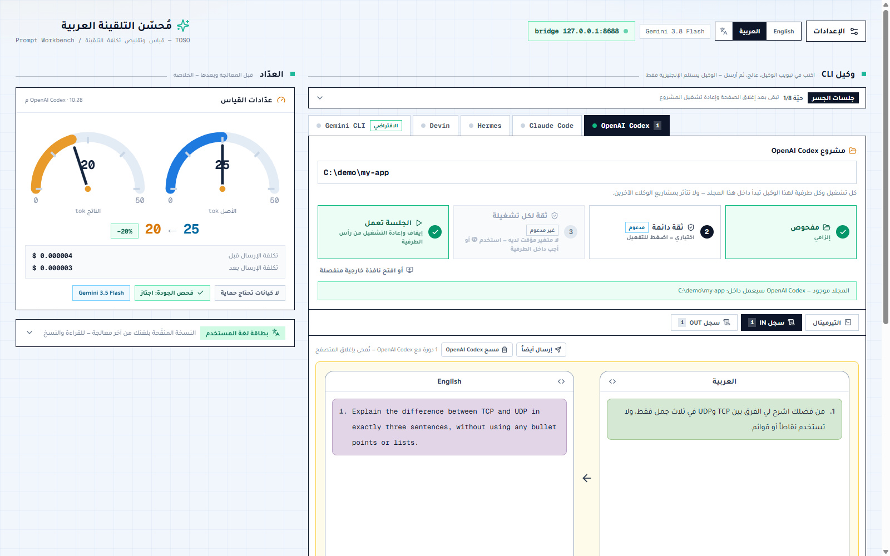

<div dir="rtl">

# TOSO

**أنفق توكنز أقل في كل مهمة برمجة بالذكاء الاصطناعي: قبل أن يقرأ الوكيل تلقينتك، وأثناء
عمله.** ينقّي TOSO تلقينتك ويختصرها، ويترجمها إلى الإنجليزية إن كتبتها بلغة أخرى،
ويرسلها إلى وكيل البرمجة في سطر الأوامر الذي تختاره، ويتيح لك التحكم بعدة وكلاء
من شاشة واحدة.

[English](README.md) · [الأدلة العلمية](Docs/RESEARCH.md) · [دليل التشغيل والاستخدام](Docs/setup-and-usage.md) · [المرجع التقني](Docs/ARCHITECTURE.md) · رخصة MIT



---

## الفكرة

التوكنز هي الفاتورة. ويخفّضها TOSO في موضعين:

**1 · في المدخلات: ما ترسله (ثلاث طبقات)**

| #   | الطبقة                       | ماذا تفعل                                                                                                                                                                                   |
| --- | ---------------------------- | ------------------------------------------------------------------------------------------------------------------------------------------------------------------------------------------- |
| ①   | **المعالجة الداخلية**        | تنقية حتمية على جهازك بلا شبكة: تحذف التحيات والحشو وتكرار المسافات، ولا تمسّ الكود ولا الروابط ولا JSON ولا الاقتباسات ولا `{المتغيرات}`. تعمل بالعربية والإنجليزية، حتى بلا أي مفتاح API. |
| ②   | **نموذج مجاني يعيد الصياغة** | يختصر Gemini الصياغة دون تغيير المهمة. يعمل بمفتاحك المجاني من [AI Studio](https://aistudio.google.com/)، فتكلفة المعالجة المسبقة **صفر** (الشروط أدناه).                                   |
| ③   | **الترجمة إلى الإنجليزية**   | التلقينة بغير الإنجليزية تُترجم أولاً إلى إنجليزية مختصرة، فالمعنى نفسه يكلّف توكنز أقل. **العربية مدعومة اليوم**، والمدخل الإنجليزي يتخطى الترجمة. انظر [السبب](#المشكلة).                 |

**2 · في التنفيذ: كيف يعمل الوكيل (فكرتان)**

| #   | الفكرة                      | ماذا تفعل                                                                                                                                                                   |
| --- | --------------------------- | --------------------------------------------------------------------------------------------------------------------------------------------------------------------------- |
| ④   | **وكلاء CLI عبر واجهة**     | يعمل الوكيل بالنص والأوامر في طرفية حقيقية بدل لقطات شاشة، فتنخفض تكلفة معالجته ومخرجاته. ويمنح TOSO تلك الطرفية واجهة سهلة.                                                |
| ⑤   | **عدة وكلاء في شاشة واحدة** | لكل من Gemini CLI وClaude Code وOpenAI Codex وDevin وHermes تبويب بطرفيته الحيّة ومدخله وسجل IN / OUT الخاص به. شغّلها جنباً إلى جنب، وأعد إرسال تلقينة إلى وكيل آخر بضغطة. |

**ينقل TOSO العمل اللغوي من رصيد وكيلك المدفوع إلى حصة Gemini المجانية.**

## المشكلة

المطوّر الذي يفكّر بالعربية أو الهندية أو الروسية أو الصينية يدفع أكثر لاستخدام
وكلاء البرمجة بالذكاء الاصطناعي من المطوّر الذي يكتب بالإنجليزية، للطلب نفسه.

- **الضريبة اللغوية.** المعنى نفسه يستهلك توكنز أكثر في لغات كثيرة: نحو **3 أضعاف**
  للعربية على مرمّز GPT-4، وحتى 15 ضعفاً لبعض اللغات
  ([Petrov وآخرون، NeurIPS 2023](https://arxiv.org/abs/2305.15425)). ومتحدثو لغات
  كثيرة يدفعون أكثر ويحصلون على نتائج أسوأ
  ([Ahia وآخرون، EMNLP 2023](https://arxiv.org/abs/2305.13707)).
- **الترجمة حل مُثبت.** ترجمة النص إلى لغة أكفأ قبل إرساله للنموذج خفّضت التكلفة
  حتى 90% بجودة مماثلة أو أفضل ([Nag وآخرون، 2024](https://arxiv.org/abs/2403.05434)).
- **القناة تهم أيضاً.** في دراسة مضبوطة على 440 مهمة، أنهى وكلاء سطر الأوامر (CLI)
  مهامهم أسرع من وكلاء الشاشة (GUI) على النموذج نفسه، وبلغوا نجاحاً 69.3% (مقابل
  59.1% للواجهة الرسومية) بعد سد فجوة المهارات، وهو حد أعلى تشخيصي بتعبير الباحثين
  ([Zhou وآخرون، 2026](https://arxiv.org/abs/2606.24551)). ولقطات الشاشة سياق مكلف:
  اللقطة الواحدة 1920×1080 نحو 1500–2700 توكن
  ([محسوبة من وثائق المزودين](Docs/RESEARCH.md)).

## كيف تسير التلقينة

<div dir="ltr">

```
 your prompt                TOSO                                   your CLI agent
 (Arabic or English)  ──▶  ① clean up locally (no network)
                           ② rewrite with a free Gemini model
                           ③ Arabic → concise English
                              (English input: no translation)
                           guard entities, negation, coverage
                                           English only  ───────▶  Gemini CLI · Claude Code
                                                                    Codex · Devin · Hermes
 reply in your         ◀──  translate the reply back  ◀── captured from the live terminal
 language                   (on demand for English input)
```

</div>

| #   | الطبقة                          | الدليل                                                                                                         |
| --- | ------------------------------- | -------------------------------------------------------------------------------------------------------------- |
| ①   | المعالجة الداخلية               | لا نذكر رقماً منشوراً. يعرض TOSO قياس التوكنز قبل/بعد لتلقينتك أنت.                                            |
| ②   | نموذج مجاني يتولى إعادة الصياغة | [أسعار Gemini](https://ai.google.dev/gemini-api/docs/pricing)                                                  |
| ③   | الإنجليزية بدل لغتك عند الوكيل  | [Petrov 2023](https://arxiv.org/abs/2305.15425)، [Nag 2024](https://arxiv.org/abs/2403.05434)، وقياس TOSO نفسه |
| ④   | وكيل CLI بدل وكيل واجهة رسومية  | [Zhou 2026](https://arxiv.org/abs/2606.24551)، [Bechard 2026](https://arxiv.org/abs/2604.00073)                |
| ⑤   | عدة وكلاء من شاشة واحدة         | ميزة سير عمل، ولا ندّعي لها توفيراً                                                                            |

## أرقام مقاسة، لا مفترضة

يعدّ TOSO التوكنز بأداة `countTokens` من Gemini، وهي مطابقة للفوترة، ويعرض الأرقام
الحقيقية لتلقينتك أنت: الأصل، والمنقّح محلياً، والإنجليزية النهائية.

على مجموعة من 12 تلقينة عربية مع ترجماتها الإنجليزية بالمعنى نفسه، استهلكت العربية
**1.36 ضعف توكنز الإنجليزية لنفس المعنى** على مرمّز Gemini، فوفّرت النسخة الإنجليزية
نحو 26% ([التقرير](Docs/reports/token-benchmark.md)). مرمّز Gemini رفيق نسبياً
بالعربية؛ والمرمّزات المتمحورة حول الإنجليزية تفرض عليها ضريبة أكبر بكثير، فقد يكون
التوفير عند وكيلك أكبر. المنهجية والحدود والمصادر كاملة:
**[Docs/RESEARCH.md](Docs/RESEARCH.md)**.

## شاهده يعمل

الوكيل يعمل فعلاً داخل طرفية حيّة في الصفحة، ودور TOSO أن يقرر ما يستلمه فقط. وهذا سجل OUT بعد أن ردّ الوكيل وتُرجم رده إلى العربية:


## المزايا

- **قياس حقيقي للتوكنز** للأصل والتنقية المحلية والإنجليزية النهائية، بعدّادين
  وخريطة حرارية للمقاطع.
- **واجهة عربية وإنجليزية** بزر تبديل (RTL ↔ LTR)؛ وفي الإنجليزية تختفي عناصر ترجمة الرد لأنه أصلاً بلغتك.
- **مدخل عربي وإنجليزي.** العربي يُترجم إلى الإنجليزية، والإنجليزي يُنقّى ويُختصر
  بلا ترجمة، والنسخة العربية على بعد ضغطة إن أردت قراءتها («عرض النسخة العربية»).
- **حراسة المعنى:** الأرقام والتواريخ والروابط و`{المتغيرات}` و`{{المتغيرات}}`
  والاقتباسات يجب أن تبقى، وفقدان النفي يُنبَّه عليه، وإذا فشلت إعادة الصياغة
  يُستخدم الناتج المحلي.
- **قاعدة الإنجليزية فقط:** الوكلاء لا يستلمون النص العربي أبداً، وكل طرق الإرسال
  ترفض النص الذي أغلبه عربي.
- **خمسة وكلاء CLI في شاشة واحدة** بطرفيات حيّة مدمجة: Gemini CLI وClaude Code
  وOpenAI Codex وDevin وHermes. لكل وكيل مدخله، فلا يذهب النص إلى وكيل خاطئ،
  والجلسة تتذكر السياق بين الدورات.
- **مجلد مشروع لكل وكيل** بتسلسل: فحص ← ثقة اختيارية ← تشغيل. لا يعمل وكيل على مجلد لم يُفحص.
- **سجل IN / OUT** لكل وكيل ولكل دورة، مع ترجمة الرد؛ ويمكن إعادة إرسال نصوص سابقة
  إلى وكيل آخر دون معالجتها من جديد.
- **لوحة جلسات الجسر:** ترى الجلسات الحيّة وتعود إليها أو تنهيها، وتفتح المغلقة.
- **جسر محلي** مربوط بـ`127.0.0.1` فقط، بتوكن جلسة وقائمة وكلاء ثابتة. انظر [SECURITY.md](SECURITY.md).

## البدء السريع

يتطلب **Node.js 22.12 أو أحدث**، ووكيل CLI واحداً على الأقل مثبّتاً ومسجّل الدخول.

<div dir="ltr">

```bash
git clone <this-repo>
cd TOSO
npm install
npm run dev:all
```

</div>

يشغّل `dev:all` التطبيق (`http://localhost:3000`) والجسر المحلي معاً، ويقرنهما
تلقائياً، ويفتح المتصفح. بعدها:

1. **الإعدادات ←** ضع مفتاحك المجاني من [Google AI Studio](https://aistudio.google.com/).
2. **تبويب الوكيل ←** أدخل مجلد مشروعك ← ① فحص ← ④ تشغيل الجلسة.
3. اكتب تلقينتك في **مدخل الوكيل** نفسه ← **معالجة** (تُستبدل مسودتك في مكانها
   بالنسخة الإنجليزية المختصرة) ← **إرسال**. ومفتاح «إرسال مباشرة بعد المعالجة»
   يجعلها ضغطة واحدة. ويمكن إعادة إرسال نصوص سابقة إلى وكيل آخر من سجل IN / OUT
   («إرسال أيضاً») بلا معالجة جديدة.

### للاستخدام اليومي: نسخة الإنتاج

`dev:all` للعمل على TOSO نفسه. للاستخدام فقط شغّل النسخة المحسّنة؛ تُبنى مرة واحدة ثم يبدأ التطبيق والجسر بالطريقة نفسها:

<div dir="ltr">

```bash
npm run start:all
```

</div>

يستمع الاثنان على `127.0.0.1` فقط. لتغيير منفذ التطبيق أضف `-- -p 4000`، ولعرضه على شبكتك عن قصد أضف `-- -H 0.0.0.0`.

الدليل خطوة بخطوة: [Docs/setup-and-usage.md](Docs/setup-and-usage.md).

## الطبقة المجانية: اعرف شروطها

- `gemini-3.8-flash` (الافتراضي) و`gemini-3.5-flash-lite` مجانيان على الطبقة
  المجانية؛ أما `gemini-3.1-pro-preview` فلا.
- **الخصوصية:** على الطبقة المجانية تذكر Google أن المحتوى _قد يُستخدم لتحسين
  منتجاتها_، وعلى الطبقة المدفوعة لا يُستخدم. لا تضع كوداً سرياً في التلقينات على
  الطبقة المجانية.
- تنطبق [حدود الاستخدام](https://ai.google.dev/gemini-api/docs/rate-limits) المجانية.
- الطريق المجاني هو **مفتاحك الشخصي من AI Studio**. مفتاح الخادم (`AGENT_PLATFORM_API_KEY`)
  لمن يشغّل نسخة خاصة لفريقه فقط؛ يستخدم Agent Platform المدفوع من Google، فاتركه فارغاً.
- بلا أي مفتاح تعمل التنقية المحلية (①) فقط؛ إعادة الصياغة عبر Gemini والترجمة غير
  متاحتين، ويصرّح TOSO بذلك.

## ليس خدمة مستضافة

TOSO برنامج حر تشغّله بنفسك، وليس SaaS: بلا حسابات ولا فوترة ولا حدود استعمال ولا بيانات محفوظة على خادم. كل ما يهم يجري على جهازك: وكلاء CLI والجسر ومفتاحك وسجلك (في تخزين المتصفح). ولا يصلح أصلاً موقعاً عاماً: الوكلاء على حاسوبك، والجسر لا يجيب إلا `127.0.0.1`. وإن استضفت الصفحة لفريق فلا تضع مفتاح خادم إلا إن رضيت بدفع تكلفة طلبات الجميع.

## الحالة والحدود

TOSO نموذج أولي يعمل، وهو أول مشروع مفتوح المصدر لصاحبه.

- المدخل والواجهة اليوم **عربيان وإنجليزيان**.
- التوفير يُقاس على **مرمّز Gemini**، ومرمّز وكيلك مختلف.
- التقاط الرد يقرأ شاشة طرفية كل وكيل؛ واجهة وكيل جديدة قد تحتاج قاعدة جديدة،
  والردود الطويلة من الوكلاء ذوي الشاشة الكاملة قد تُقتطع.
- الترجمة قد تفقد بعض الدقة؛ الحراسة تلتقط الخسائر الظاهرة، لا كل تغيّر في المعنى.
- دراستا CLI مقابل GUI ورقتان أوليتان من 2026، وقد تتغير نتائجهما بعد التحكيم.

## خارطة الطريق

مطلوب مساهمون — هذه مفتوحة للمجتمع وليست مجدولة:

- **لغات إضافية** للمدخل والواجهة: **الصينية والروسية والهندية**، اخترناها لأن ضريبتها اللغوية قابلة للقياس وتتفاوت كثيراً. طبقة الترجمة جاهزة (`lib/i18n`)، وتحتاج كل لغة قواعد تنقية وفحوصها الخاصة — انظر [Docs/future-ideas.md](Docs/future-ideas.md).
- مقياس أكبر قابل للإعادة لعدة لغات، عبر مسار القياس في TOSO نفسه.
- جلسات حرة بعيداً عن تبويبات الوكلاء الثابتة ([الفكرة](Docs/future-ideas.md)).

## التوثيق

| الملف                                              | المحتوى                                                         |
| -------------------------------------------------- | --------------------------------------------------------------- |
| [Docs/RESEARCH.md](Docs/RESEARCH.md)               | كل ادعاء بمصدره ومستوى دليله، وما لا ندّعيه (بالإنجليزية)       |
| [Docs/setup-and-usage.md](Docs/setup-and-usage.md) | التثبيت والتشغيل والإعدادات الأولية وخطوات كل وكيل وحل المشكلات |
| [Docs/ARCHITECTURE.md](Docs/ARCHITECTURE.md)       | المرجع التقني: المسار والواجهات البرمجية والجسر والحراسة        |
| [SECURITY.md](SECURITY.md)                         | التعامل مع المفاتيح ونموذج أمان الجسر المحلي                    |

## الرخصة

[MIT](LICENSE) © 2026 khaledaalharbi والمساهمون في TOSO.

</div>
