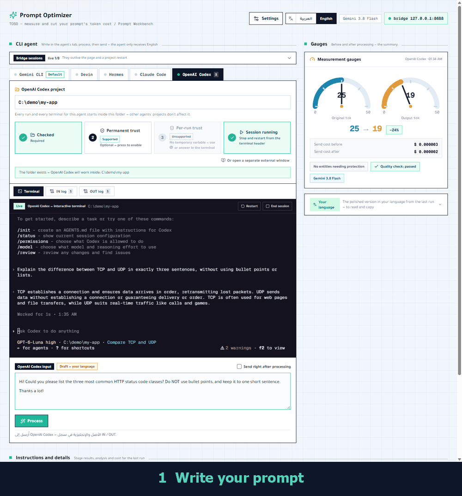
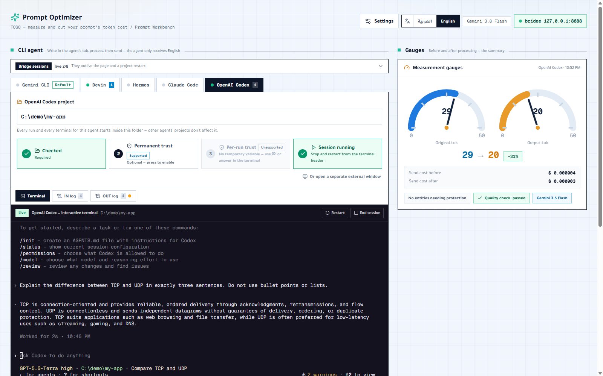

<p align="center">
  
</p>

<h1 align="center">TOSO</h1>

<p align="center"><i>Token Optimizer &amp; Session Orchestrator</i></p>

<p align="center">
  <b>Spend fewer tokens on every AI coding task — before the agent reads your prompt, and while it works.</b><br>
  Free · local · Arabic + English · five CLI coding agents on one screen
</p>

<p align="center">
  <a href="https://github.com/khaledaalharbi/TOSO/actions/workflows/ci.yml"></a>
  <a href="LICENSE"></a>
  
</p>

<p align="center">
  <a href="#quick-start">Quick start</a> ·
  <a href="Docs/getting-started.md">Full guide</a> ·
  <a href="Docs/RESEARCH.md">Evidence</a> ·
  <a href="Docs/ARCHITECTURE.md">Architecture</a> ·
  <a href="CONTRIBUTING.md">Contributing</a> ·
  <a href="README.ar.md">العربية</a>
</p>

<p align="center">
  
</p>

TOSO cleans and tightens your prompt, translates it to English when you write in
another language, sends it to the CLI coding agent of your choice, and lets you
drive several agents from one screen. Everything runs on your machine with your
own free Gemini key — it is **not** a hosted service.

**Contents:** [The idea](#the-idea) · [Quick start](#quick-start) · [How to use it](#how-to-use-it) · [Why it saves tokens](#why-it-saves-tokens) · [Features](#features) · [Troubleshooting](#troubleshooting) · [FAQ](#faq) · [Free tier](#free-tier-know-the-conditions) · [Status](#status-and-limits) · [Roadmap](#roadmap) · [Documentation](#documentation)

---

## The idea

Tokens are the bill. TOSO cuts them in two places:

**1 · On the input — what you send (three layers)**

| #   | Layer                        | What it does                                                                                                                                                                                                     |
| --- | ---------------------------- | ---------------------------------------------------------------------------------------------------------------------------------------------------------------------------------------------------------------- |
| ①   | **Local processing**         | Deterministic cleanup on your machine, no network: drops greetings, filler and repeated spacing; never touches code, URLs, JSON, quotes or `{variables}`. Works in Arabic and English, even without any API key. |
| ②   | **A free model rewrites it** | Gemini tightens the wording without changing the task. It runs on your own free [AI Studio](https://aistudio.google.com/) key, so the preprocessing costs **$0** (conditions below).                             |
| ③   | **Translation to English**   | A non-English prompt is translated to concise English first — the same meaning costs fewer tokens. **Arabic is supported today**; English input skips translation.                                               |

**2 · On the execution — how the agent works (two ideas)**

| #   | Idea                             | What it does                                                                                                                                                                                              |
| --- | -------------------------------- | --------------------------------------------------------------------------------------------------------------------------------------------------------------------------------------------------------- |
| ④   | **CLI agents, driven from a UI** | The agent works through text and commands in a real terminal instead of screenshots of a screen, which lowers the cost of its processing and its output. TOSO gives that terminal a friendly interface.   |
| ⑤   | **Many agents, one screen**      | Gemini CLI, Claude Code, OpenAI Codex, Devin and Hermes each get a tab with their own live terminal, prompt box and IN / OUT log. Run them side by side and re-send a prompt to another agent in a click. |

**TOSO moves language work from your paid agent's budget to Gemini's free quota.**

## Quick start

**You need:** [Node.js](https://nodejs.org/) 22.12 or newer, and at least one CLI agent installed and logged in
([Gemini CLI](https://github.com/google-gemini/gemini-cli), Claude Code, Codex, Devin or Hermes — install commands in the [full guide](Docs/getting-started.md#3-install-and-log-in-to-a-cli-agent)).
Works on Windows and macOS out of the box; Linux needs build tools for the embedded terminal ([details](Docs/getting-started.md#linux)).

```bash
git clone https://github.com/khaledaalharbi/TOSO.git
cd TOSO
npm install
npm run start:all      # builds once, then starts the app and the agent bridge
```

Your browser opens at `http://127.0.0.1:3000` and the app pairs with the bridge
automatically. For hacking on TOSO itself use `npm run dev:all` instead. Both
commands listen on `127.0.0.1` only (`-- -p 4000` changes the port, `-- -H 0.0.0.0`
exposes the app on your network at your own risk).

## How to use it

1. **Add your key.** Settings → paste a free [Google AI Studio](https://aistudio.google.com/) key. Without a key only the local cleanup runs.
2. **Set up an agent.** Open its tab, enter the project folder, then ① **Check folder** → ④ **Start session**. No agent ever runs on an unchecked folder.
3. **Write in your own language** in that agent's prompt box → **Process**. Your draft is replaced in place by the concise English version, and the gauges show the saving.
4. **Send.** The agent receives English only and answers in its live terminal. A per-agent switch makes steps 3–4 one click.
5. **Read the result** in the **IN log** (what you wrote next to what was sent) and the **OUT log** (the reply, translated back if you want). Past prompts can be re-sent to another agent from the log with no new processing.



Prefer Arabic? Switch the interface with the **العربية | English** toggle at the top.
The complete, step-by-step guide is in [Docs/getting-started.md](Docs/getting-started.md)
(Arabic: [Docs/setup-and-usage.md](Docs/setup-and-usage.md)).

## Why it saves tokens

Developers who think in Arabic, Hindi, Russian or Chinese pay more to use AI
coding agents than developers who write in English — for the same request.

- **The language tax.** The same meaning costs more tokens in many languages:
  ≈3× for Arabic on the GPT-4 tokenizer, up to 15× for some languages
  ([Petrov et al., NeurIPS 2023](https://arxiv.org/abs/2305.15425)). Speakers of
  many languages are charged more while getting worse results
  ([Ahia et al., EMNLP 2023](https://arxiv.org/abs/2305.13707)).
- **Translation is a proven fix.** Translating to an efficient language before
  calling the model cut cost by up to 90% with comparable or better quality
  ([Nag et al., 2024](https://arxiv.org/abs/2403.05434)).
- **The channel matters too.** In a controlled study of 440 desktop tasks, CLI
  agents finished faster than screen-driven GUI agents on the same model, and
  reached 69.3% success (vs 59.1% for GUI) once their skill coverage was patched —
  a diagnostic upper bound, per the authors
  ([Zhou et al., 2026](https://arxiv.org/abs/2606.24551)). Screenshots are
  expensive context: one 1920×1080 screenshot is roughly 1,500–2,700 tokens
  ([calculated from vendor docs](Docs/RESEARCH.md)).

How a prompt flows:

```
 your prompt                TOSO                                   your CLI agent
 (Arabic or English)  ──▶  ① clean up locally (no network)
                           ② rewrite with a free Gemini model
                           ③ Arabic → concise English
                              (English input: no translation)
                           guard entities, negation, coverage
                                           English only  ───────▶  Gemini CLI · Claude Code
                                                                    Codex · Devin · Hermes
 reply in your         ◀──  translate the reply back  ◀── captured from the live terminal
 language                   (on demand for English input)
```

| #   | Layer                                         | Evidence                                                                                                              |
| --- | --------------------------------------------- | --------------------------------------------------------------------------------------------------------------------- |
| ①   | Local processing                              | No published figure is claimed. TOSO shows the measured before/after tokens of _your_ prompt.                         |
| ②   | A free model does the rewriting               | [Gemini pricing](https://ai.google.dev/gemini-api/docs/pricing)                                                       |
| ③   | English instead of your language at the agent | [Petrov 2023](https://arxiv.org/abs/2305.15425), [Nag 2024](https://arxiv.org/abs/2403.05434), TOSO's own measurement |
| ④   | A CLI agent instead of a GUI agent            | [Zhou 2026](https://arxiv.org/abs/2606.24551), [Bechard 2026](https://arxiv.org/abs/2604.00073)                       |
| ⑤   | Several agents from one screen                | A workflow feature — no saving is claimed for it                                                                      |

**Measured, not assumed.** TOSO counts tokens with Gemini's billing-exact
`countTokens` and shows the real numbers for _your_ prompt — original, cleaned,
and final English. On a 12-prompt Arabic/English parallel corpus, Arabic cost
**1.36× the tokens of English for the same meaning** on Gemini's tokenizer, so
the English version saved ≈26% ([report](Docs/reports/token-benchmark.md)).
Gemini's tokenizer is relatively kind to Arabic; English-centric tokenizers tax it
far more, so the saving at your agent can be larger. Full method, limits and
sources: **[Docs/RESEARCH.md](Docs/RESEARCH.md)**.

## Features

- **Real token measurement** of the original, the local cleanup and the final
  English, with two gauges and a per-segment heat map.
- **Arabic and English interface** with a one-click switch (RTL ↔ LTR); in English the reply-translation controls disappear because replies are already in your language.
- **Arabic and English input.** Arabic is translated to English; English is
  cleaned and tightened without translation, with the Arabic version one click
  away if you want to read it («عرض النسخة العربية»).
- **Meaning guards:** numbers, dates, URLs, `{variables}` and `{{variables}}`,
  and quotes must survive; lost negation is flagged; a failing rewrite falls back
  to the local cleanup.
- **English-only rule:** agents never receive the Arabic text — mostly-Arabic text
  is refused on every send path. Every send also ends with `Respond in English.`,
  so an agent whose project files are in Arabic doesn't answer in Arabic.
- **Five CLI agents on one screen**, in live embedded terminals: Gemini CLI,
  Claude Code, OpenAI Codex, Devin, Hermes. Each has its own prompt box, so a
  prompt can't go to the wrong agent, and sessions keep context across turns.
- **Per-agent project folder** with a check → optional trust → start sequence;
  no agent ever runs on an unchecked folder.
- **IN / OUT transcript** per agent and per turn, with the reply translated back;
  past prompts can be re-sent to another agent without being processed again.
- **Bridge sessions panel:** see which sessions are live, reconnect to them, end
  them or reopen closed ones.
- **Local bridge** bound to `127.0.0.1` with a session token and a fixed agent
  allowlist — see [SECURITY.md](SECURITY.md).

## Troubleshooting

| Symptom                                       | Fix                                                                                                                          |
| --------------------------------------------- | ---------------------------------------------------------------------------------------------------------------------------- |
| Header badge says the bridge is offline       | Run `npm run start:all` (or `npm run bridge` in another terminal). It must be on `127.0.0.1:8676`.                           |
| "Token rejected"                              | Restart both; the app pairs automatically. If you set a token by hand in Settings, clear it.                                 |
| An agent says `Not logged in` / is not found  | Log in once from your normal terminal, make sure its command is on `PATH`, then **restart TOSO** (the bridge copies `PATH`). |
| Nothing is sent / "check the folder first"    | Finish step ① (Check folder) in that agent's tab; the message appears inside the tab.                                        |
| Reply shows "waiting for a decision"          | The agent asked a permission question in its terminal — answer it there, then send again.                                    |
| Rewrite unavailable, only local cleanup works | No key, or its quota is used up — open Settings → **Verify** / **Check models**.                                             |

More cases (Git `NUL` error, Hermes quota, environment-variable key shadowing) in the
[full guide](Docs/getting-started.md#7-troubleshooting).

## FAQ

**Does TOSO send my code anywhere?** Only your _prompt text_ goes to Gemini (for the rewrite/translation), through your own key. The agents run locally and talk to their own providers exactly as they do outside TOSO. Keep confidential code out of prompts on the free tier (see below).

**Is it a SaaS or a website I can use online?** No. It is a program you run yourself; the agents live on your computer and the bridge answers `127.0.0.1` only.

**Which agents work?** Gemini CLI, Claude Code, OpenAI Codex, Devin and Hermes. Any other CLI agent can be added through `TOSO_AGENTS_FILE` (see [ARCHITECTURE](Docs/ARCHITECTURE.md)).

**Why does the agent get English even when I write Arabic?** That is the point: the same meaning costs fewer tokens in English, and TOSO translates the reply back for you.

**Can I use it without any key?** Yes — only the local cleanup runs; the Gemini rewrite and translation say they are unavailable.

## Free tier: know the conditions

- `gemini-3.8-flash` (default) and `gemini-3.5-flash-lite` are free of charge on
  the Gemini free tier; `gemini-3.1-pro-preview` is not.
- **Privacy:** on the free tier Google states content may be _used to improve its
  products_; on the paid tier it is not. Keep confidential code out of prompts on
  the free tier.
- Free-tier [rate limits](https://ai.google.dev/gemini-api/docs/rate-limits) apply.
- The free path is **your own AI Studio key**. The server key (`AGENT_PLATFORM_API_KEY`)
  is only for someone running a private copy for their own team; it uses Google's
  billed Agent Platform — leave it unset.
- Without any key, only the local cleanup (①) runs; the Gemini rewrite and the
  translation are unavailable and TOSO says so.

**Not a hosted service.** TOSO is free software you run yourself: no accounts, no
billing, no rate limits, no data kept on a server. Everything that matters happens
on your machine — the CLI agents, the bridge, your key and your history (browser
storage). If you host the page somewhere for a team, do not set a server key unless
you are happy to pay for everyone's calls.

## Status and limits

TOSO is a working prototype and the author's first open-source project.

- Input and interface today are **Arabic and English**.
- Savings are measured on **Gemini's tokenizer**; your agent's tokenizer differs.
- Reply capture reads each agent's terminal screen; a new agent UI may need a new
  rule. Long replies from full-screen agents can be truncated.
- Translation can lose nuance — the guards catch visible losses, not every shift
  in meaning.
- The CLI-vs-GUI studies are 2026 preprints; their results may change on review.

## Roadmap

Help wanted — these are open for the community, not scheduled:

- **More languages** for input and interface: **Chinese, Russian, Hindi** — chosen
  because their token tax is measurable and varies widely. The translation layer
  is ready (`lib/i18n`); each language needs its own cleanup rules and checks —
  see [Docs/future-ideas.md](Docs/future-ideas.md).
- A larger, reproducible multi-language benchmark using TOSO's measurement path.
- Free-form sessions beyond the fixed agent tabs ([idea](Docs/future-ideas.md)).

## Documentation

| Document                                           | Contents                                                              |
| -------------------------------------------------- | --------------------------------------------------------------------- |
| [Docs/getting-started.md](Docs/getting-started.md) | Install, run, settings, per-agent steps, daily use, troubleshooting   |
| [Docs/setup-and-usage.md](Docs/setup-and-usage.md) | The same guide in Arabic                                              |
| [Docs/RESEARCH.md](Docs/RESEARCH.md)               | Every claim with its source, evidence level, and what we do not claim |
| [Docs/ARCHITECTURE.md](Docs/ARCHITECTURE.md)       | Technical reference: pipeline, API routes, bridge, guards (Arabic)    |
| [SECURITY.md](SECURITY.md)                         | Key handling and the local bridge threat model                        |
| [CONTRIBUTING.md](CONTRIBUTING.md)                 | Set up, the four CI checks, project rules, adding a language          |
| [CHANGELOG.md](CHANGELOG.md)                       | What changed in each release                                          |
| [CODE_OF_CONDUCT.md](CODE_OF_CONDUCT.md)           | How we treat each other                                               |

## License

[MIT](LICENSE) © 2026 khaledaalharbi and TOSO contributors.
